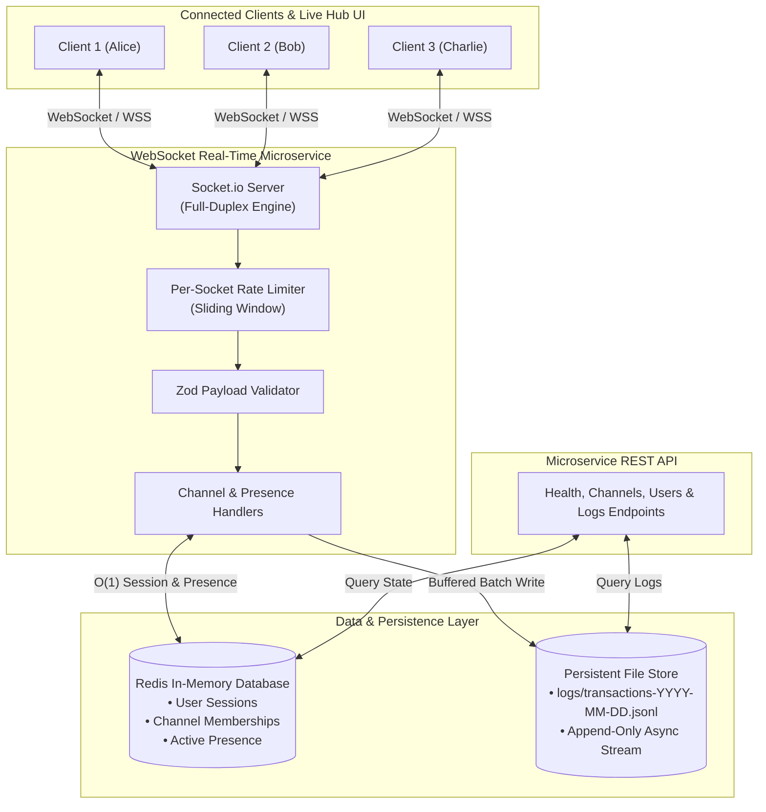
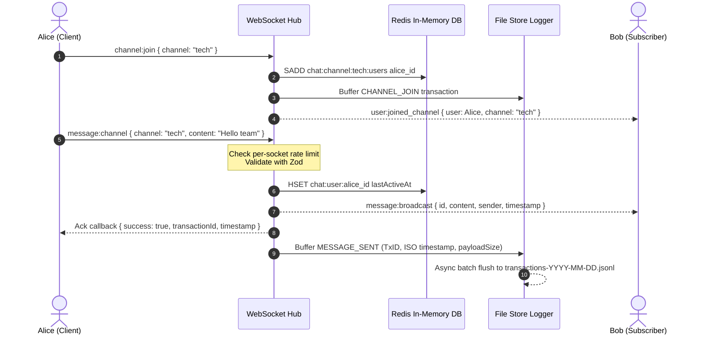

# Concurrent WebSocket Real-Time Communication Hub

A high-concurrency instant messaging backend microservice engineered with **Node.js**, **TypeScript**, **Express**, and **Socket.io**, featuring an active in-memory database (**Redis**) for online presence and user caching, and a non-blocking append-only persistent file store for transaction audit timestamps.

---

## 🌟 Key Features & Highlights

- **Full-Duplex Real-Time Pipelines**: Bidirectional event-driven communication powered by **Socket.io** over native WebSockets with automatic transport fallback.
- **Multiple Dynamic Chat Channels**: Scalable channel isolation supporting default channels (`#general`, `#tech`, `#announcements`, `#random`) as well as on-demand dynamic channels.
- **Direct 1-on-1 Messaging**: Private point-to-point communication channel between connected users with guaranteed delivery acknowledgements.
- **In-Memory Database Caching (Redis)**:
  - Active user profiles and session metadata cached with O(1) lookups.
  - Channel membership sets and room occupancy tracking.
  - Reverse socket-to-user mappings for rapid disconnect resolution.
  - Seamless zero-config in-memory mock fallback when an external Redis server is not locally running.
- **Persistent File Store Audit Logging**:
  - High-throughput asynchronous write stream with non-blocking batch flushing.
  - Persistent append-only JSONL files (`logs/transactions-YYYY-MM-DD.jsonl`) recording high-precision ISO timestamps, transaction IDs, latency metrics, and payload sizes.
  - Queryable REST API with filtering by channel, event type, and sender.
- **High Concurrency & Protection**:
  - Per-socket sliding-window rate limiting to prevent message flooding and DDoS attacks.
  - Strict input validation powered by **Zod**.
  - Bidirectional heartbeat ping-pong pipeline measuring live latency and maintaining connection health.
- **Interactive Web Client / Dashboard**: Embedded sleek real-time UI served at `/` to test channels, live presence, typing indicators, and file store transaction audit logs.
- **Production-Grade Testing Suite**: 100% automated test coverage across 6 test suites (23 passing tests) + standalone 100-client concurrency benchmark script.

---

## 🏗️ System Architecture



---

## ⚡ Concurrency & Message Pipeline



---

## 💾 Redis In-Memory Data Models

| Key | Redis Type | Description |
| :--- | :--- | :--- |
| `chat:user:<userId>` | `Hash` | Cached user session (`userId`, `username`, `socketId`, `connectedAt`, `lastActiveAt`, `channels`) |
| `chat:active_users` | `Set` | Set of all active online user IDs |
| `chat:socket:<socketId>` | `String` | Reverse lookup mapping socket ID to `userId` for O(1) disconnect cleanup |
| `chat:channel:<name>:users` | `Set` | Set of user IDs subscribed to a specific channel |
| `chat:user_channels:<userId>` | `Set` | Set of channel names a user currently occupies |
| `chat:channels` | `Set` | Registry of all active default and dynamically created channels |
| `chat:channel_meta:<name>` | `Hash` | Channel metadata (`name`, `description`, `createdAt`, `isDefault`) |

---

## 📁 Persistent File Store Specification

Message transactions are asynchronously streamed into daily append-only files inside `logs/` formatted as JSON Lines (`.jsonl`):

### Sample Transaction Record:
```json
{
  "transactionId": "b48c66e2-2a78-4394-bb9e-994c653ff9d1",
  "timestamp": "2026-11-14T22:27:35.812Z",
  "epochMs": 1794724055812,
  "event": "MESSAGE_SENT",
  "senderId": "user_alice",
  "senderUsername": "Alice",
  "target": "tech",
  "payloadSize": 38,
  "status": "SUCCESS",
  "latencyMs": 2.4,
  "details": {
    "messageId": "a1f9485c-8951-4e4b-9728-cb42b87e2bdf"
  }
}
```

### Supported Transaction Events:
- `USER_CONNECT`: Socket connection handshake authenticated and cached.
- `USER_DISCONNECT`: Disconnection cleanup and session teardown.
- `CHANNEL_JOIN`: User joined channel room.
- `CHANNEL_LEAVE`: User vacated channel room.
- `MESSAGE_SENT`: Public channel message broadcast.
- `DIRECT_MESSAGE_SENT`: 1-on-1 private direct message routed.
- `HEARTBEAT`: Full-duplex ping-pong round-trip transaction.
- `RATE_LIMITED`: Attempted transmission throttled by sliding-window rate limiter.

---

## 📡 WebSocket Event API Specification

### Client to Server Events

| Event | Payload | Acknowledgement Callback | Description |
| :--- | :--- | :--- | :--- |
| `channel:join` | `{ channel: string }` | `(res: ApiResponse) => void` | Joins a chat channel room and updates Redis cache |
| `channel:leave` | `{ channel: string }` | `(res: ApiResponse) => void` | Vacates a chat channel room |
| `channel:list` | — | `(res: ApiResponse<{ channels }>) => void` | Retrieves list of all channels and active counts |
| `message:channel` | `{ channel: string, content: string }` | `(res: ApiResponse<{ messageId, transactionId }>) => void` | Sends message to all channel subscribers |
| `message:direct` | `{ recipientId: string, content: string }` | `(res: ApiResponse<{ messageId, transactionId }>) => void` | Sends 1-on-1 direct message |
| `typing:start` | `{ channel?: string, recipientId?: string }` | — | Broadcasts typing indicator |
| `typing:stop` | `{ channel?: string, recipientId?: string }` | — | Clears typing indicator |
| `heartbeat:ping` | `{ clientTimestamp: number }` | `(res: { serverTimestamp, latencyMs }) => void` | Round-trip latency measurement |
| `users:active` | — | `(res: ApiResponse<{ users }>) => void` | Lists all online users from Redis cache |

### Server to Client Events

| Event | Payload | Description |
| :--- | :--- | :--- |
| `message:broadcast` | `ChatMessage` | Broadcasted message to channel subscribers |
| `message:direct` | `ChatMessage` | Private message delivered to recipient and echoed to sender |
| `user:joined_channel` | `{ channel, user, timestamp }` | Notification that a user joined a channel |
| `user:left_channel` | `{ channel, user, timestamp }` | Notification that a user vacated a channel |
| `user:presence_update` | `{ userId, username, status, timestamp }` | Real-time online/offline presence broadcast |
| `typing:indicator` | `{ userId, username, channel, isTyping }` | Remote user typing indicator |
| `error:rate_limit` | `{ message, retryAfterMs }` | Emitted when message rate threshold is breached |
| `error:validation` | `{ message, details }` | Emitted when payload fails Zod schema validation |

---

## 🌐 Microservice REST API Endpoints

| Method | Endpoint | Description |
| :--- | :--- | :--- |
| `GET` | `/health` | Server uptime, memory metrics, active sockets, Redis status, and logger stats |
| `GET` | `/api/channels` | Returns all channels with current active subscriber counts |
| `GET` | `/api/channels/:name/users` | Returns list of active users in a specific channel |
| `GET` | `/api/users/active` | Returns all online users cached in Redis |
| `GET` | `/api/logs/transactions` | Query persistent audit logs (`limit`, `channel`, `event`, `senderId`) |
| `GET` | `/api/logs/stats` | Aggregated persistent file store operational metrics |

---

## 📂 Project Directory Structure

```
Task_Three/
├── logs/                         # Persistent file store directory
│   └── transactions-*.jsonl      # Append-only transaction audit logs
├── public/                       # Interactive Web Testing Hub (Embedded Frontend)
│   ├── index.html                # UI layout & responsive chat interface
│   ├── style.css                 # Modern dark-mode stylesheet
│   └── app.js                    # Client Socket.io controller & real-time handlers
├── scripts/
│   └── benchmark.ts              # High-concurrency 100-client stress test script
├── src/
│   ├── config/
│   │   └── env.ts                # Zod-validated environment configurations
│   ├── handlers/
│   │   ├── channel.handler.ts    # Channel join/leave/list socket listeners
│   │   ├── connection.handler.ts # Connection handshake, auth, Redis caching, disconnect
│   │   ├── message.handler.ts    # Broadcast, direct messaging, acks, file logging
│   │   └── presence.handler.ts   # Typing indicators, heartbeat ping-pong, user queries
│   ├── middleware/
│   │   ├── rateLimiter.ts        # Per-socket sliding-window rate limiter
│   │   └── validator.ts          # Zod message schemas & payload sanitizers
│   ├── routes/
│   │   ├── api.routes.ts         # REST API routes (channels, users, persistent logs)
│   │   └── health.routes.ts      # Health check and telemetry metrics
│   ├── services/
│   │   ├── channel.service.ts    # Channel registry & membership state
│   │   ├── logger.service.ts     # Persistent asynchronous file store transaction logger
│   │   └── redis.service.ts      # In-memory Redis cache & presence service with auto-mock
│   ├── types/
│   │   ├── events.ts             # Strongly-typed Socket.io event interfaces
│   │   └── index.ts              # Core domain models (User, Message, Channel, TransactionLog)
│   ├── app.ts                    # Express application configuration & security
│   ├── server.ts                 # Server bootstrap & graceful shutdown lifecycle
│   └── websocket.ts              # Socket.io initialization & middleware
├── tests/
│   ├── api.test.ts               # REST API tests
│   ├── channels.test.ts          # Channel isolation & dynamic multi-channel tests
│   ├── concurrency.test.ts       # High-concurrency multi-client stress tests
│   ├── logger.test.ts            # Persistent file store & timestamp validation tests
│   ├── redis.test.ts             # Redis session caching & presence tests
│   └── websocket.test.ts         # End-to-end WebSocket communication tests
├── .env.example                  # Environment configuration template
├── package.json                  # Dependencies & scripts
├── requests.http                 # HTTP test suite for REST endpoints
├── tsconfig.json                 # TypeScript compiler configuration
└── vitest.config.ts              # Test runner configuration
```

---

## 🚀 Getting Started

### 1. Prerequisites
- **Node.js**: `v20.0.0` or higher (tested on `v24.11.0`)
- **npm**: `v10.0.0` or higher
- **Redis** *(Optional)*: If Redis is not installed, the application automatically boots into in-memory mock mode.

### 2. Installation
```bash
npm install
```

### 3. Environment Configuration
Copy `.env.example` to `.env`:
```bash
cp .env.example .env
```

### 4. Running Development Server
```bash
npm run dev
```
The server will start on `http://localhost:3000`.

### 5. Open Interactive Web Client Hub
Open `http://localhost:3000` in your web browser. You can open multiple browser windows or tabs to simulate concurrent users chatting in real-time, switching channels, testing direct messages, and viewing live persistent transaction logs.

---

## 🧪 Testing & Verification

### Run Complete Automated Test Suite (Vitest)
```bash
npm test
```
Runs 23 automated tests across 6 suites verifying:
- Active user session caching in Redis.
- Channel isolation and multi-channel routing.
- Direct messaging privacy.
- High-concurrency packet delivery without loss.
- Persistent file store JSONL writing and transaction timestamp logging.
- REST microservice API endpoints.

### Run High-Concurrency Benchmark (100 Concurrent Clients)
```bash
npm run benchmark
```
Spawns 100 concurrent WebSocket clients sending 1,000 messages across multiple channels, measuring:
- Throughput (messages/second).
- Latency distribution (min, mean, p50, p95, p99, max).
- Redis active user cache verification.
- Persistent file store transaction audit logging integrity.

### Benchmark Performance Output:
```
=============================================================
  📊 BENCHMARK RESULTS SUMMARY
=============================================================
  Total Messages Sent:        1000
  Total Broadcasts Delivered: 55780
  Test Execution Duration:    1101 ms
  Throughput:                 908.27 messages/sec
  Latency Metrics (Round-Trip Ack):
    - Min:                    715 ms
    - Average:                907.38 ms
    - Median (P50):           911 ms
    - 95th Percentile (P95):   1075 ms
    - 99th Percentile (P99):   1090 ms
    - Max:                    1090 ms
  Redis Cache Accuracy:       100/100 (100%)
  File Store Transactions:    1200 records logged
  Log File Path:              logs/transactions-2026-11-14.jsonl
=============================================================
```

---

## 📝 License

ISC License. Built for Backend Engineering Internship Task 3.
